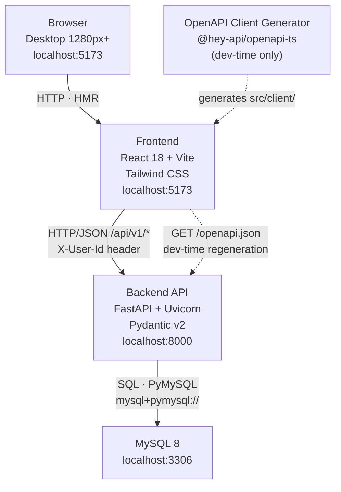
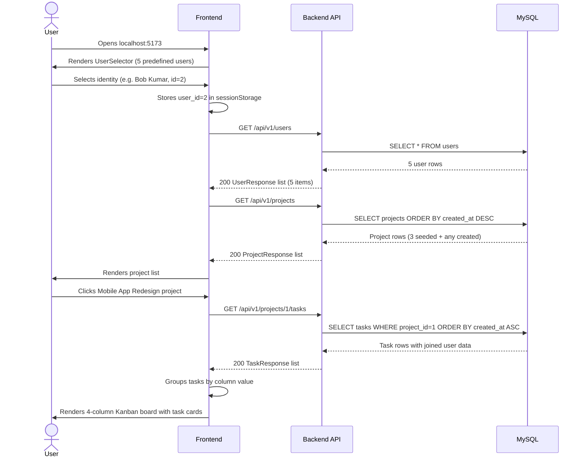
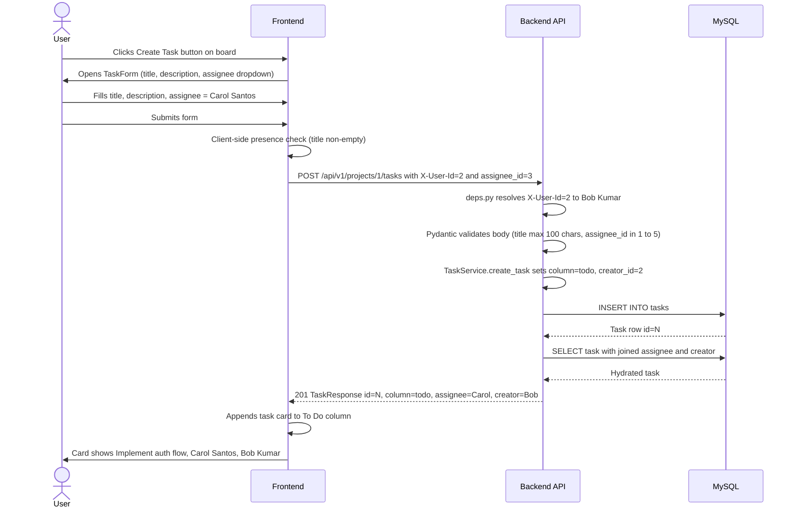
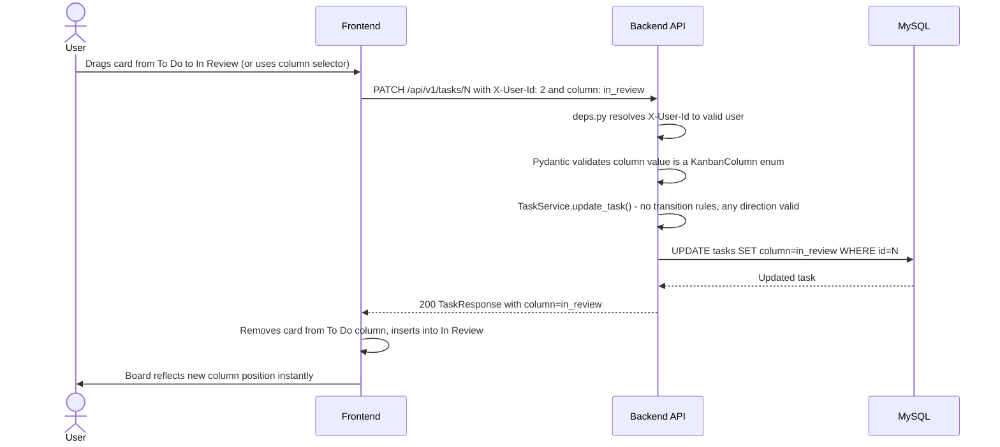
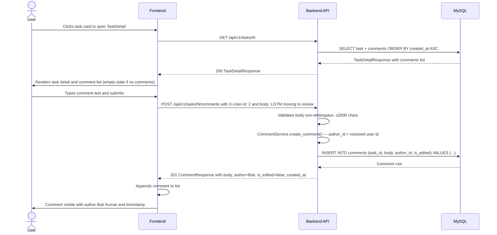
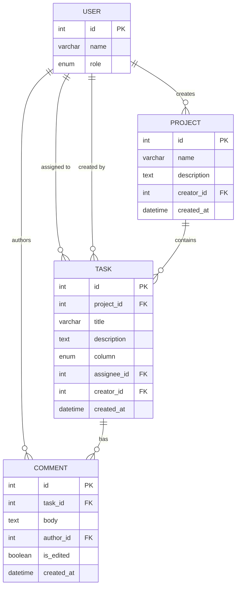
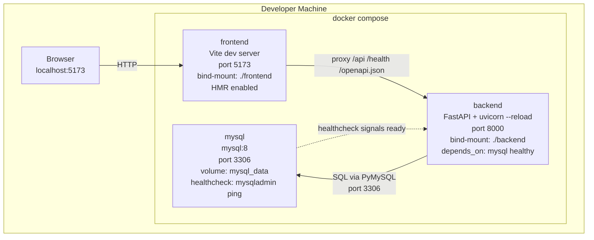

# High-Level Design: Team Kanban Board

**Branch**: `001-team-kanban-board` | **Date**: 2026-11-19 | **Spec**: [spec.md](../specs/001-team-kanban-board/spec.md) | **Plan**: [plan.md](../specs/001-team-kanban-board/plan.md)

**Status**: Draft

---

## 1. Overview

Taskify phase 1 is a team productivity platform that lets five predefined team members
(one product manager, four engineers) create projects, manage tasks on a Kanban board,
and collaborate through comments — all without a login screen. Users select their identity
from a fixed list at session start, and that identity is attached to every task and comment
they create. The board presents tasks in four columns (To Do / In Progress / In Review /
Done) and allows unrestricted movement in any direction. Three sample projects are
pre-seeded so the board is immediately useful on first launch (SC-004).

The system is delivered as a full-stack web application: a FastAPI backend serving a
versioned REST API, a React 18 SPA consuming a generated TypeScript client, and MySQL 8
for persistence — all orchestrated by a single `docker compose up`.

**Deferred for phase 2**: real authentication (OAuth2/JWT), real-time multi-user sync,
microservice extraction, and mobile/tablet support.

---

## 2. System Architecture



| Component | Technology | Responsibility |
|-----------|-----------|----------------|
| Browser | Chrome / Firefox / Safari (desktop) | Renders the React SPA; runs at `localhost:5173` |
| Frontend | React 18 · Vite · TypeScript · Tailwind CSS | SPA: routing, UI, state, generated API client |
| Backend API | FastAPI · Uvicorn · Pydantic v2 · SQLAlchemy 2.0 | REST API, business logic, validation, seed data |
| MySQL 8 | mysql:8 Docker image | Persistent storage for all domain data |
| OpenAPI Client Generator | @hey-api/openapi-ts | Dev-time tool: generates `src/client/` from `/openapi.json` |

---

## 3. Component Descriptions

### 3.1 Frontend (React 18 + Vite)

**Purpose**: Single-page application that renders the Kanban board, handles user identity
selection, and communicates with the backend exclusively through the generated typed client.

**Internal structure** (from `plan.md`):
```
src/
├── client/          # Generated — never hand-edited; regenerated via npm run generate-client
├── components/      # board/, tasks/, projects/, ui/
├── pages/           # ProjectsPage (/) · BoardPage (/projects/:id)
├── hooks/           # useCurrentUser, useProjects, useTasks, useComments
├── store/           # userStore.ts — current identity in sessionStorage
└── lib/             # apiClient.ts — configures base URL + X-User-Id injection
```

**Owns**: UI rendering, client-side routing (React Router), user identity state,
optimistic UI updates, inline validation display.

**Does NOT own**: Business logic, data persistence, server-side validation, auth tokens.

**Key decisions**: Vite proxies `/api`, `/health`, and `/openapi.json` to the backend
in development — no CORS configuration needed. The generated client in `src/client/`
is committed to the repo and listed in `.eslintignore`.

---

### 3.2 Backend API (FastAPI)

**Purpose**: Serves the REST API, enforces all validation and business rules, manages
the database via SQLAlchemy, seeds initial data on startup, and exposes `/openapi.json`
for client generation.

**Internal layered structure** (strict layer boundaries — no layer skipping):
```
api/routes/    HTTP only: parse request, call service, return response
services/      Business logic: orchestrate, enforce rules, no direct DB
repositories/  DB access only: CRUD via SQLAlchemy ORM, no business logic
models/        SQLAlchemy ORM table definitions
schemas/       Pydantic v2 request/response schemas (the API contract)
```

**Owns**: REST endpoints, request/response schema validation, business rule enforcement,
database writes, seed data, identity resolution from `X-User-Id` header.

**Does NOT own**: UI state, session management, authentication tokens.

**Key decisions**: Synchronous SQLAlchemy with PyMySQL (async driver not needed for phase 1
load). Every endpoint has an explicit `response_model` so the OpenAPI schema is fully typed.
Settings loaded via `pydantic-settings` from `.env`; `.env.example` committed, `.env` gitignored.

---

### 3.3 MySQL 8

**Purpose**: Durable persistence for all domain entities (users, projects, tasks, comments).

**Owns**: Data storage and referential integrity (FK constraints, CASCADE rules).

**Does NOT own**: Business logic, validation (enforced upstream by Pydantic + services).

**Key decisions**: Schema managed by Alembic (autogenerate from `Base.metadata`). Seed
data inserted via idempotent startup hook — not via Alembic data migrations.
A separate `taskify_test` database is used for the pytest suite.

---

## 4. Data Flow — Key User Journeys

### P1 — View Projects and Kanban Board



---

### P2 — Create and Assign Task



---

### P3 — Move Task Across Columns



---

### P4 — Comment on Task



---

## 5. Data Model Summary



> Full column definitions, validation constraints, indexes, and migration strategy:
> see [`data-model.md`](../specs/001-team-kanban-board/data-model.md).

---

## 6. API Surface

**Identity mechanism**: `X-User-Id: <int>` request header on all write operations.
Backend resolves it to a seeded user; rejects with HTTP 401 if missing or invalid.
GET endpoints require no header. See [`contracts/api.md`](../specs/001-team-kanban-board/contracts/api.md) for full
request/response shapes.

| Resource | Method | Path | Auth Required |
|----------|--------|------|---------------|
| Health | GET | `/health` | No |
| Users | GET | `/api/v1/users` | No |
| Projects | GET | `/api/v1/projects` | No |
| Projects | POST | `/api/v1/projects` | Yes |
| Projects | GET | `/api/v1/projects/{id}` | No |
| Tasks | GET | `/api/v1/projects/{id}/tasks` | No |
| Tasks | POST | `/api/v1/projects/{id}/tasks` | Yes |
| Tasks | GET | `/api/v1/tasks/{id}` | No |
| Tasks | PATCH | `/api/v1/tasks/{id}` | Yes |
| Comments | GET | `/api/v1/tasks/{id}/comments` | No |
| Comments | POST | `/api/v1/tasks/{id}/comments` | Yes |
| Comments | PATCH | `/api/v1/comments/{id}` | Yes |
| Comments | DELETE | `/api/v1/comments/{id}` | Yes |

---

## 7. Deployment Architecture



**Startup sequence**:
1. `mysql` starts and passes its `mysqladmin ping` healthcheck
2. `backend` starts (depends on mysql healthy), runs `alembic upgrade head`, then
   `seed/seed_data.py` (idempotent), then begins serving on port 8000
3. `frontend` starts independently; Vite proxy routes to backend once it is ready

**Environment differences**:

| Concern | Local (Docker Compose) | Production intent |
|---------|----------------------|-------------------|
| TLS | None — HTTP only | Terminate at load balancer / reverse proxy |
| Auth | `X-User-Id` header (phase 1) | OAuth2 / JWT (phase 2) |
| DB | Named Docker volume | Managed RDS / Cloud SQL instance |
| Hot reload | `--reload` + HMR | Gunicorn workers; built SPA assets |
| Secret management | `.env` file | Cloud secret manager |

---

## 8. Cross-Cutting Concerns

### Security

| Concern | Approach | Status |
|---------|----------|--------|
| Credentials / secrets | `pydantic-settings` from `.env`; `.env.example` committed; `.env` gitignored | PASS |
| Input validation server-side | Pydantic v2 schemas on every request body; rejected before service layer | PASS |
| Generic errors to clients | FastAPI exception handlers suppress stack traces; structured 4xx responses only | PASS |
| Identity enforcement | `X-User-Id` validated server-side in `deps.py`; rejects unknown IDs with HTTP 401 | PASS (phase 1 substitute) |
| Authentication / authorization | No login in phase 1 — **JUSTIFIED DEVIATION** (see §9) | DEVIATION |
| TLS | Enforced at deployment layer; not in local Docker dev | DEFERRED |

### Input Validation

Validation is enforced at every layer with no gaps:

```
Browser form       → HTML5 required + maxlength attributes (UX only; not a security boundary)
  ↓
Frontend           → Client-side presence check before API call (reduces round trips)
  ↓
HTTP transport     → Pydantic v2 schema on request body (type · range · length · format)
                     Rejects with 422 and per-field error array on failure
  ↓
Service layer      → Business rule checks (e.g., assignee_id exists in seeded users)
  ↓
Repository layer   → SQLAlchemy column constraints (NOT NULL, VARCHAR(100), ENUM)
  ↓
MySQL              → Final enforcement: FK integrity, column type bounds
```

Validation logic is centralized per domain in `app/schemas/`; no ad-hoc checks in routes.

### Observability

| Signal | Mechanism |
|--------|-----------|
| Health check | `GET /health` returns `{status, db}` — polled by orchestrator readiness probe |
| Application logs | Python `logging` module via uvicorn; structured JSON format recommended for production |
| Request logs | Uvicorn access log (stdout in Docker) |
| DB query tracing | SQLAlchemy `echo=True` available via `DATABASE_ECHO` env var (dev only) |
| Frontend errors | Browser console in dev; production error boundary (React) logs to console |

No distributed tracing or metrics pipeline is in scope for phase 1.

### Error Handling

Errors propagate upward and are transformed at each boundary:

```
MySQL constraint violation
  → SQLAlchemy raises IntegrityError
  → Repository re-raises or returns None
  → Service raises domain exception (e.g., ResourceNotFoundError)
  → Route catches and maps to HTTP 404 / 409
  → FastAPI serialises to {"detail": "..."} — no stack trace
  → Frontend receives structured error body
  → Component displays inline validation message or toast notification
```

Unhandled exceptions are caught by FastAPI's default handler and return HTTP 500
with a generic message; the full traceback is written to stdout (server-side only).

---

## 9. Constitution Alignment

| Principle | Status | Evidence / Rationale |
|-----------|--------|----------------------|
| I — Security-First | ⚠️ JUSTIFIED DEVIATION | Secrets in env vars ✓; server-side validation ✓; generic errors ✓; `X-User-Id` validated server-side ✓; **no JWT/OAuth2** — time-bounded to phase 1 trusted internal team; must resolve before phase 2 |
| II — Input Validation | PASS | Pydantic v2 centralized schemas; allow-list field constraints; 422 per-field errors; frontend shows inline messages (SC-007, SC-008) |
| III — Microservices Architecture | ⚠️ JUSTIFIED DEVIATION | Phase 1 is a modular monolith; each domain module (users/projects/tasks/comments) is independently structured for future extraction; OpenAPI spec is the versioned contract; `GET /health` satisfies health-check requirement |
| IV — Full Documentation | REQUIRED | Docstrings mandatory on all public functions/endpoints; enforced by mypy + ruff in CI; `backend/README.md` and `frontend/README.md` required before merge |

---

## 10. Constraints and Known Tradeoffs

- **No authentication (phase 1)**: Any user knowing the port can impersonate any team
  member by sending any `X-User-Id`. Accepted: trusted local team, no network exposure.
  Must be resolved before phase 2.

- **Synchronous SQLAlchemy + PyMySQL**: Chosen over async because PyMySQL cannot drive
  an async engine. Sufficient for phase 1 (5 users, desktop browser). Migration to
  `aiomysql` + async SQLAlchemy possible in phase 2 without changing business logic.

- **No real-time sync**: Each browser session is independent. If two users are on the
  same board simultaneously, one will see stale data until they refresh. Accepted for
  phase 1 (small team, internal use). WebSocket/SSE sync deferred to phase 2.

- **Session-scoped persistence**: Data lives in MySQL for the full application lifetime,
  but identity state lives in `sessionStorage` and is lost on tab close. Closing and
  reopening requires re-selecting identity.

- **Modular monolith**: Backend is a single FastAPI application, not separate
  microservices. Chosen to meet the `docker compose up` single-command constraint and to
  validate domain boundaries before extraction. Layer isolation (routes → services →
  repositories → models) is enforced to make future extraction straightforward.

- **Generated client committed to repo**: `src/client/` is generated and committed.
  Trade-off: slightly larger repo; benefit: type-safe API calls without a live backend
  for CI/CD pipelines that only run frontend tests.

- **Starter baseline milestone**: The first working increment is health check + Users
  list endpoint only, proving the full FastAPI → SQLAlchemy → MySQL → OpenAPI →
  generated client → React chain before the Kanban domain is built on top.

---

## 11. Open Questions and Future Considerations

- **Authentication (Principle I deviation)**: Replace `X-User-Id` header with OAuth2 +
  JWT before any network-exposed deployment. This will require a login page, token
  refresh logic, and per-request authorization middleware. Deferred to phase 2 (spec
  Assumptions section).

- **Real-time board sync**: Multiple users on the same board see stale state until
  refresh. WebSocket (FastAPI native) or Server-Sent Events are the natural next step.
  Deferred to phase 2 (spec Assumption: "no real-time sync in phase 1").

- **Microservice extraction (Principle III deviation)**: When team and load justify it,
  each domain module (projects, tasks, comments) can become an independent service.
  The layered structure and OpenAPI contract are designed to make this extraction
  low-friction. Deferred to a future phase.

- **Soft-delete for tasks and comments**: Currently both are hard-deleted. If audit
  trail or recovery requirements emerge, adding a `deleted_at` column and filtering in
  repositories is a contained change.

- **Role-based permissions**: The spec explicitly defers role distinctions (product
  manager vs. engineer) to labeling only. If phase 2 introduces permission differences
  (e.g., only PM can delete projects), the `role` column in the `users` table is
  already in place.

- **Mobile / tablet support**: Deferred to a future phase (spec Assumptions). The
  Tailwind CSS utility-first approach makes responsive breakpoints additive.
